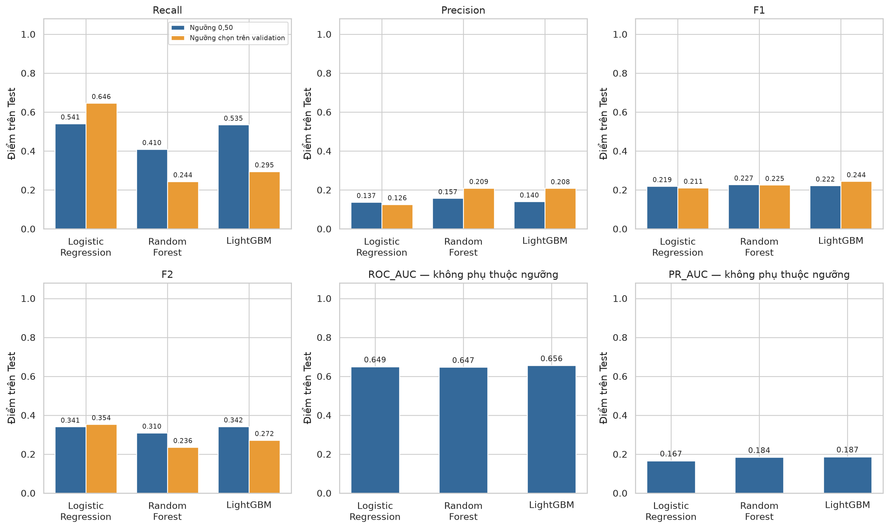

# Dự đoán tái nhập viện <30 ngày ở bệnh nhân tiểu đường

Dự án triển khai đầy đủ **Bước 1–6**: EDA, làm sạch, tiền xử lý, chọn đặc trưng,
Logistic Regression / Random Forest / LightGBM, tinh chỉnh ngưỡng và đánh giá.
Notebook có giải thích tiếng Việt, bảng kết quả và ảnh cho báo cáo môn học.

## Xem kết quả ngay trên GitHub

- [Báo cáo tổng hợp và kết quả đánh giá](outputs/report.md)
- [Notebook tiếng Việt có sẵn kết quả và biểu đồ](notebooks/diabetes_readmission_pipeline.ipynb)
- [Bảng so sánh ba thuật toán ở hai ngưỡng](outputs/tables/model_comparison.csv)
- [Nguồn và giấy phép dữ liệu UCI](DATA_SOURCES.md)



Mã nguồn, hai CSV UCI, notebook đã chạy, báo cáo, biểu đồ và các bảng tổng hợp được đưa
lên GitHub. Môi trường `.venv`, công cụ `.tools`, cache, mô hình nhị phân đã fit và các
bản sao Train/Test được tạo lại khi chạy dự án, không lưu trong Git.

## Chạy dự án

Trên máy đã dựng môi trường `.venv`, có thể chạy trực tiếp như dưới đây.
Nếu vừa clone từ GitHub, hãy tạo môi trường theo hướng dẫn ở phần tiếp theo trước.

```powershell
cd D:\DataMining
.\.venv\Scripts\python.exe main.py
.\.venv\Scripts\python.exe -m unittest discover -s tests -v
.\.venv\Scripts\python.exe -m jupyterlab
```

Mở `notebooks/diabetes_readmission_pipeline.ipynb`, chọn kernel `.venv`, rồi **Run All**.
Trong VS Code: **Select Kernel → Python Environments → .venv\Scripts\python.exe**.
Không cần activate hay thay đổi PowerShell ExecutionPolicy.

Nếu dựng lại môi trường, dùng Python 3.11/3.12:

```powershell
py -3.12 -m venv .venv
.\.venv\Scripts\python.exe -m pip install -r requirements-lock.txt
.\.venv\Scripts\python.exe main.py
```

`requirements-lock.txt` chứa phiên bản chính xác đã cài; `requirements.txt` khai báo các thư viện cần thiết.
Lần chạy sau tái sử dụng kết quả nếu dữ liệu, mã huấn luyện, hàm threshold/metric, cấu hình
và phiên bản thư viện khớp. Dùng `--retrain` để tìm kiếm lại. Notebook dùng cùng cơ chế.

```powershell
# Chỉ chạy Bước 1–3
.\.venv\Scripts\python.exe main.py --stage preprocessing

# Tạo lại báo cáo từ mô hình đã khóa, không tuning lại
.\.venv\Scripts\python.exe main.py --stage report

# Mở rộng tìm kiếm, cần nhiều thời gian hơn mặc định
.\.venv\Scripts\python.exe main.py --iterations 20 --cv-folds 5 --retrain

# Đổi sàn Precision của validation: thực hiện một thí nghiệm mới
.\.venv\Scripts\python.exe main.py --min-precision 0.25 --retrain
```

Có thể chỉ định `--data-dir`, `--output-dir`, `--jobs`, `--shap-samples`.
`--stage report` yêu cầu cùng cấu hình lần huấn luyện. `--no-plots` chỉ bỏ biểu đồ EDA;
biểu đồ so sánh mô hình vẫn được tạo khi chạy đầy đủ.

## Cấu trúc

```text
DataMining/
├── diabetic_data.csv                         # Giữ nguyên nguồn
├── IDS_mapping.csv                           # Ba bảng mã hành chính
├── requirements.txt
├── requirements-lock.txt
├── main.py                                   # Điều phối cả sáu bước
├── src/
│   ├── preprocessing.py                      # Cohort, split, sklearn Pipeline
│   ├── eda.py                                # EDA và biểu đồ mô tả
│   ├── feature_selection.py                  # ANOVA + LightGBM gain, top-k
│   ├── models.py                             # CV, class weights, refit
│   └── evaluate.py                           # Threshold, metric, SHAP, báo cáo
├── notebooks/diabetes_readmission_pipeline.ipynb
├── tests/test_preprocessing.py
├── tests/test_modeling.py
└── outputs/
    ├── report.md                             # Báo cáo kết quả tự động
    ├── figures/                              # 5 EDA + 11 biểu đồ mô hình
    ├── tables/                               # CV/threshold/metric/ranking/audit
    ├── processed/                            # Raw Train/Test và ma trận kiểm tra
    └── artifacts/                            # 3 pipeline .joblib + metadata + SHAP
```

## Quy trình và chống rò rỉ dữ liệu

**Dự đoán tại thời điểm xuất viện**, khi đã biết thời gian nằm viện, chẩn đoán, thuốc
trong đợt điều trị và tình trạng xuất viện. Không diễn giải là dự đoán lúc mới nhập viện.

1. `?`, `Unknown/Invalid`, chuỗi rỗng → NaN. Giữ chuỗi xét nghiệm `None` lúc đọc
   vì nghĩa là chưa đo. Nhãn 1 cho `<30`, 0 cho `NO` / `>30`; nhãn sai/thiếu gây lỗi.
2. Chọn encounter_id dạng số nhỏ nhất mỗi patient_nbr **trước** khi loại disposition
   11, 13, 14, 19, 20, 21. Không thay ca đầu bị loại bằng một ca muộn hơn.
   CSV không có timestamp: ID nhỏ nhất chỉ là quy ước chọn bản ghi đại diện tái lập,
   không chứng minh lần nhập viện đầu theo thời gian thực tế.
3. Outer Train/Test 80/20, stratify, seed 42, không giao bệnh nhân. Bỏ cả hai ID và nhãn khỏi X;
   lưu ID riêng để audit. Trong Train tách development 80% / threshold validation 20%.
4. RandomizedSearchCV trên development: mặc định 6 cấu hình × 3 fold mỗi thuật toán,
   tổng 54 lượt fit CV ngoài refit. Chọn siêu tham số theo **Average Precision**.
   Mỗi fold fit riêng preprocessing, selector và classifier trên phần Train của fold.
5. Fit cấu hình tốt nhất trên development, chọn threshold và thuật toán trên validation độc lập.
   Không dùng Test để chọn. Khóa lựa chọn rồi refit cả ba pipeline trên toàn outer Train.
6. Đánh giá trên cùng Test với threshold 0,50 và threshold đã khóa. Không chọn lại từ kết quả Test.

```text
69.973 bệnh nhân (6.277 nhãn dương, tỷ lệ 8,97%)
├── Outer Train: 55.978
│   ├── Development: 44.782 → CV chọn siêu tham số và số biến
│   └── Threshold validation: 11.196 → chọn ngưỡng và thuật toán
└── Test: 13.995 → đánh giá cuối cùng
```

Sau khi khóa lựa chọn, refit trên toàn bộ 55.978 bệnh nhân Train. Tỷ lệ dương sau lọc
khác khoảng 11% của dữ liệu nguồn. Không dùng ma trận .npz từ Bước 3 làm đầu vào CV.

## Tiền xử lý và kỹ thuật đặc trưng

- Bỏ weight/examide/citoglipton theo quy tắc cố định. Những cột khác hằng số hoặc thiếu >95%
  chỉ được xác định khi fit từng fold. Kết quả xét nghiệm xử lý cùng cờ đã đo.
- Race/payer_code/medical_specialty/chẩn đoán thiếu thành nhóm Missing; không giả tạo dân tộc
  hay chẩn đoán bằng mode. Mã hành chính có mô tả NULL/Not Available/Not Mapped/Unknown/Invalid cũng thành thiếu.
- ICD-9 thành chín nhóm theo Strack et al. (2014, Table 2): Circulatory 390–459/785;
  Respiratory 460–519/786; Digestive 520–579/787; Diabetes 250.xx; Injury 800–999;
  Musculoskeletal 710–739; Genitourinary 580–629/788; Neoplasms 140–239; Other gồm E/V.
  Dùng ba chữ số đầu khi mã có phần thập phân; thiếu giữ riêng.
- Tuổi ordinal 0–9. Xét nghiệm có thứ tự Norm < >200 < >300 và Norm < >7 < >8;
  chưa đo tạo severity thiếu + measured=0, impute từ Train và có missing indicator.
  Chưa đo khác bình thường; mã ordinal không phải thứ tự nguy cơ đã xác nhận.
- Thuốc mã hướng Down < Steady < Up; No dùng hướng không đổi và prescribed=0, phân biệt
  không kê với dùng liều ổn định. Đây không phải liều dùng thực hay thang nguy cơ.
  change/diabetesMed thành nhị phân. Thêm tổng lượt khám trước nhập viện, số thuốc đổi/tăng/giảm liều,
  được kê và thiếu trạng thái; không suy diễn thay đổi chưa được ghi nhận.
- Biến số: median Train → log1p nếu skew Train >1 → RobustScaler. Nominal: Missing → One-Hot
  với handle_unknown='ignore'. Ordinal/binary có nhánh riêng. Mỗi cột vào đúng một nhánh ColumnTransformer.

Toàn outer Train có 224 cột sau tiền xử lý. Các fold có thể có số cột khác do category hiếm,
nhưng selector/classifier luôn dùng schema khớp nhau. X raw CSV đọc lại bằng
`pd.read_csv(path, keep_default_na=False, na_values=[''])` để giữ None; X/y cùng thứ tự hàng.

## Chọn biến và cân bằng lớp

HybridFeatureSelector tính ANOVA F-score và LightGBM gain, lấy trung bình thứ hạng để chọn top-k.
`k ∈ {40, 80, 120, all}` được tinh chỉnh trong CV cùng hyperparameter classifier.
`all` là đối chứng khi giảm biến không cải thiện điểm CV. P-value ANOVA chưa hiệu chỉnh đa kiểm định,
chỉ để tham khảo, không dùng để tuyên bố ý nghĩa lâm sàng.

- Logistic Regression: class_weight='balanced', tinh chỉnh C.
- Random Forest: class_weight='balanced', tinh chỉnh số cây, độ sâu, kích thước lá, max_features và bootstrap sample.
- LightGBM: is_unbalance=True, tự tính tỷ lệ trong mỗi lần fit; tinh chỉnh số cây, learning rate, số lá,
  độ sâu, min child samples, regularization và row/feature subsampling.

Dùng trọng số lớp nên không cần SMOTE; không nội suy các cột danh mục đã mã hóa.
Score predict_proba có trọng số lớp **chưa được hiệu chỉnh xác suất**; không diễn giải trực tiếp
là nguy cơ lâm sàng tuyệt đối. imbalanced-learn vẫn có trong môi trường theo yêu cầu ban đầu.

## Chọn ngưỡng và metric

Quét 0,10–0,60, bước 0,01, trên validation độc lập với dữ liệu dùng CV.
Chọn F2 lớn nhất trong các threshold đạt Precision ≥20%, hòa điểm thì ưu tiên Recall.
Nếu không ngưỡng nào đạt, lấy best F2 không ràng buộc và ghi precision_constraint_met=false;
không báo sai là đã đạt sàn. Sàn 20% là cấu hình minh họa cho báo cáo, có thể đổi qua CLI,
không phải ngưỡng lâm sàng đã thẩm định. Sàn trên validation không bảo đảm Test đạt sàn.

Chọn thuật toán theo validation: đạt sàn → F2 → Recall → Average Precision.
Bảng Test có sáu hàng với Recall/Sensitivity, Precision, F1, F2, ROC-AUC, PR-AUC,
Average Precision và TN/FP/FN/TP. **PR-AUC** dùng tích phân hình thang; **AP** dùng
average_precision_score không nội suy. Hai metric báo riêng và có thể khác nhau.
AUC/AP không đổi khi chỉ thay threshold; tăng Recall có thể làm tăng FP và giảm Precision.

## File cần dùng trong báo cáo

- `outputs/report.md`: mô hình chọn trên validation, bảng Test, toàn bộ biểu đồ và giới hạn diễn giải.
- `outputs/tables/model_comparison.csv`: ba thuật toán × hai ngưỡng; `validation_metrics.csv`: lựa chọn trước Test.
- `cv_results_*.csv`: toàn bộ cấu hình/điểm CV; `threshold_curve_*.csv`: 51 threshold validation mỗi thuật toán.
- `feature_selection_*.csv`: hai ranking và thứ hạng kết hợp; `selected_features_*.csv`: tập biến giữ cho từng mô hình.
- `model_importance_*.csv`, `shap_lightgbm_importance.csv`: importance đầy đủ, tên không rút ngắn.
- `training_summary.json`, `experiment_summary.json`: cấu hình, số hàng, fingerprint, phiên bản, lựa chọn và đường dẫn.
- `outputs/artifacts/{logistic_regression,random_forest,lightgbm}.joblib`: ba pipeline raw → score.
  `best_model_metadata.json` ghi thuật toán chọn và threshold. Phân loại bằng
  `pipeline.predict_proba(X)[:,1] >= threshold`; predict() mặc định dùng 0,50.
- `shap_lightgbm.npz`: SHAP, base value, tên cột và index mẫu Train.

Biểu đồ gồm EDA, so sánh metric, 6 confusion matrix trên một hình, ROC, PR, threshold tuning,
hai phương pháp chọn biến, importance ba thuật toán và SHAP beeswarm/bar trên mẫu Train.
Hệ số LR, RF MDI và LightGBM gain có thang đo khác nhau, không so trị số tuyệt đối giữa mô hình.
SHAP theo raw log-odds, đã kiểm tra tính cộng khớp raw score. Importance/SHAP không chứng minh nhân quả.

## Kiểm chứng và nguồn

Test kiểm tra cohort/nhãn, chống trùng bệnh nhân, ICD-9, None/Norm, fit chỉ trên Train,
selector, metric/F2 tính tay, threshold không khả thi, chọn thuật toán từ validation và
vòng tuning/refit/lưu/đọc lại ba pipeline. Chạy unittest để xem kết quả hiện tại.
Dữ liệu lịch sử và quy ước bản ghi đại diện theo ID có giới hạn ngoại suy; dự án phục vụ báo cáo môn học.

- [UCI dataset](https://archive.ics.uci.edu/dataset/296/diabetes+130-us+hospitals+for+years+1999-2008).
- [Strack et al. (2014), Table 1–2](https://pmc.ncbi.nlm.nih.gov/articles/PMC3996476/).
- [Pipeline và leakage](https://scikit-learn.org/stable/common_pitfalls.html#data-leakage),
  [ANOVA](https://scikit-learn.org/stable/modules/generated/sklearn.feature_selection.f_classif.html),
  [RandomizedSearchCV](https://scikit-learn.org/stable/modules/generated/sklearn.model_selection.RandomizedSearchCV.html),
  [threshold tuning](https://scikit-learn.org/stable/modules/classification_threshold.html),
  [Average Precision](https://scikit-learn.org/stable/modules/generated/sklearn.metrics.average_precision_score.html).
- [LightGBM class weights](https://lightgbm.readthedocs.io/en/stable/pythonapi/lightgbm.LGBMClassifier.html).
- [SHAP TreeExplainer](https://shap.readthedocs.io/en/latest/generated/shap.TreeExplainer.html).
