# Kết quả dự đoán tái nhập viện <30 ngày

Cohort: 69,973 bệnh nhân; tỷ lệ dương 8.97%.
Development: 44,782; validation chọn ngưỡng: 11,196; outer Train: 55,978; Test: 13,995.

## Quy trình và lựa chọn đã khóa trước Test

RandomizedSearchCV: 6 cấu hình mỗi thuật toán, 3-fold stratified CV, refit theo Average Precision trên development.
Pipeline tiền xử lý + ANOVA/LightGBM selector đều fit riêng trong mỗi fold; số cột k là siêu tham số CV.
Dùng trọng số lớp; không dùng SMOTE. Ngưỡng quét 0,10–0,60, bước 0,01 trên validation tách biệt.
Sàn Precision trên validation = 20%; tối đa F2 trong các ngưỡng đạt sàn. Nếu không có ngưỡng đạt, dùng best F2 và báo rõ chưa đạt sàn.
Chọn **LightGBM** theo validation; threshold **0.60**. Validation Recall=0.2620, Precision=0.2011, F2=0.2470; đạt sàn=True.
Sau đó refit cả ba pipeline trên toàn outer Train và đánh giá Test. Không chọn lại mô hình/ngưỡng từ bảng Test.

## So sánh trên Test

| Thuật toán | Ngưỡng | Recall | Precision | F1 | F2 | ROC-AUC | PR-AUC | AP |
|---|---:|---:|---:|---:|---:|---:|---:|---:|
| Logistic Regression (default) | 0.50 | 0.5410 | 0.1375 | 0.2192 | 0.3409 | 0.6495 | 0.1665 | 0.1672 |
| Logistic Regression (tuned) | 0.46 | 0.6462 | 0.1259 | 0.2107 | 0.3537 | 0.6495 | 0.1665 | 0.1672 |
| Random Forest (default) | 0.50 | 0.4096 | 0.1571 | 0.2271 | 0.3100 | 0.6467 | 0.1840 | 0.1844 |
| Random Forest (tuned) | 0.58 | 0.2438 | 0.2093 | 0.2252 | 0.2360 | 0.6467 | 0.1840 | 0.1844 |
| LightGBM (default) | 0.50 | 0.5347 | 0.1402 | 0.2221 | 0.3421 | 0.6555 | 0.1870 | 0.1875 |
| LightGBM (tuned) | 0.60 | 0.2948 | 0.2083 | 0.2441 | 0.2722 | 0.6555 | 0.1870 | 0.1875 |

## Ngưỡng đã khóa từ validation

| Thuật toán | k | Threshold | Recall val | Precision val | F2 val | Đạt sàn Precision |
|---|---:|---:|---:|---:|---:|---|
| Logistic Regression | 80 | 0.46 | 0.6753 | 0.1298 | 0.3668 | Không — dùng best F2 không ràng buộc |
| Random Forest | 80 | 0.58 | 0.2291 | 0.2070 | 0.2243 | Có |
| LightGBM | 120 | 0.60 | 0.2620 | 0.2011 | 0.2470 | Có |

Threshold thỏa sàn Precision có thể cao hơn 0,50, làm giảm Recall/F2 so với ngưỡng mặc định. Đây là tối ưu có ràng buộc Precision, không phải cam kết mọi metric đều tăng sau tuning.

PR-AUC dùng tích phân hình thang của đường Precision–Recall; AP dùng average_precision_score, không nội suy. Hai giá trị được báo riêng. ROC-AUC/PR-AUC/AP không đổi khi chỉ đổi threshold.
Sàn Precision là ràng buộc chọn trên validation, không bảo đảm Precision Test cũng đạt sàn.

## Đặc trưng và diễn giải

Hai bảng xếp hạng là ANOVA F và LightGBM gain; selector lấy trung bình thứ hạng để chọn top-k.
Các p-value ANOVA là chưa hiệu chỉnh đa kiểm định và chỉ để tham khảo, không dùng để tuyên bố ý nghĩa lâm sàng.
Importance/SHAP cho thấy mô hình dùng biến nào, không chứng minh nguyên nhân tái nhập viện. SHAP được tính trên mẫu Train của LightGBM theo raw log-odds; đã kiểm tra tính cộng khớp output mô hình.
Các score predict_proba có trọng số lớp chưa được hiệu chỉnh xác suất; không diễn giải trực tiếp là nguy cơ lâm sàng tuyệt đối.
CSV không có timestamp nhập viện: encounter_id nhỏ nhất chỉ là quy ước chọn bản ghi đại diện. Thời điểm dự đoán là khi xuất viện; kết quả trên dữ liệu lịch sử này chưa phải kiểm định triển khai thực tế.

## Biểu đồ

### model_comparison

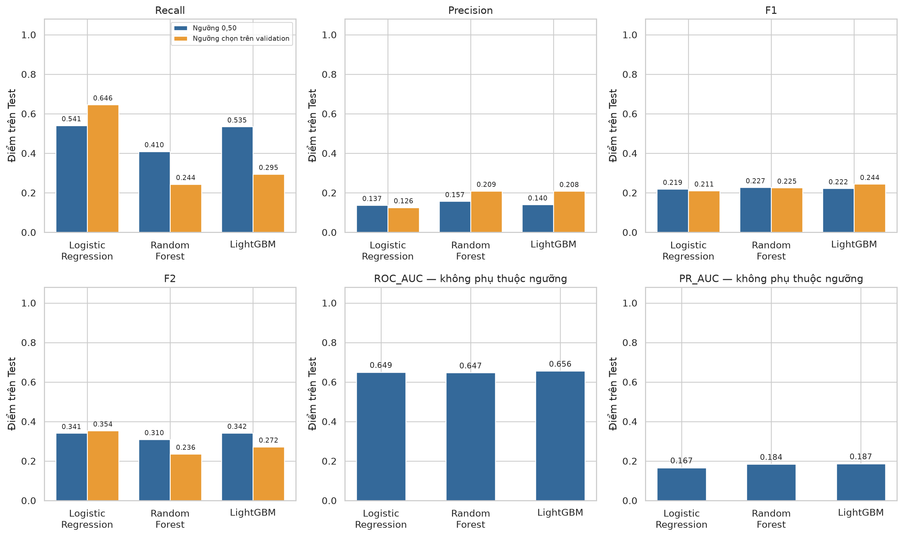

### confusion_matrices

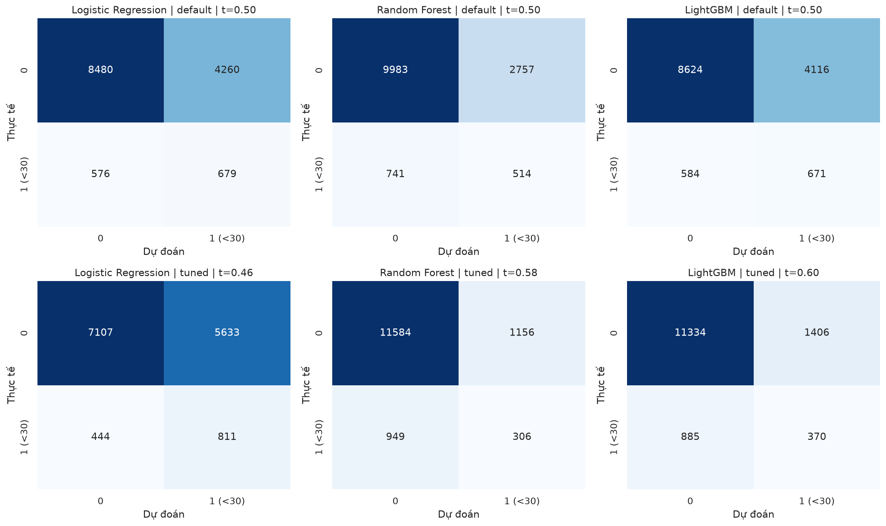

### roc_comparison

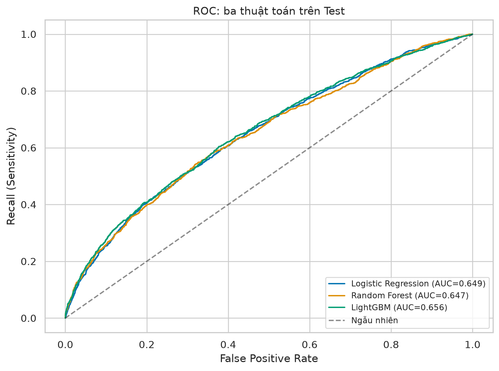

### precision_recall_comparison

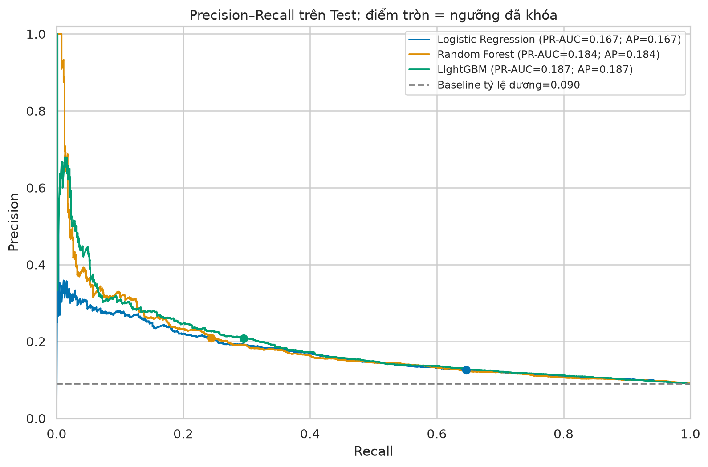

### threshold_tuning_validation

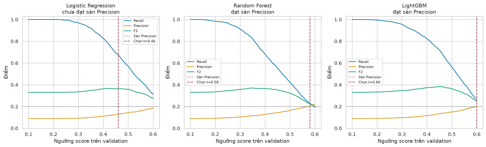

### feature_selection_methods

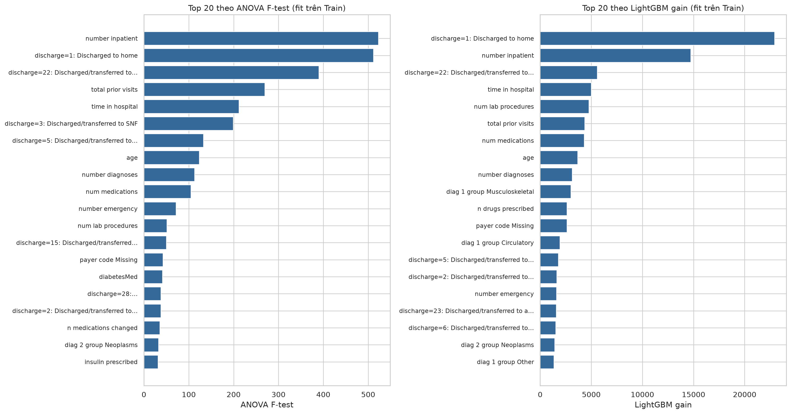

### feature_importance_logistic_regression

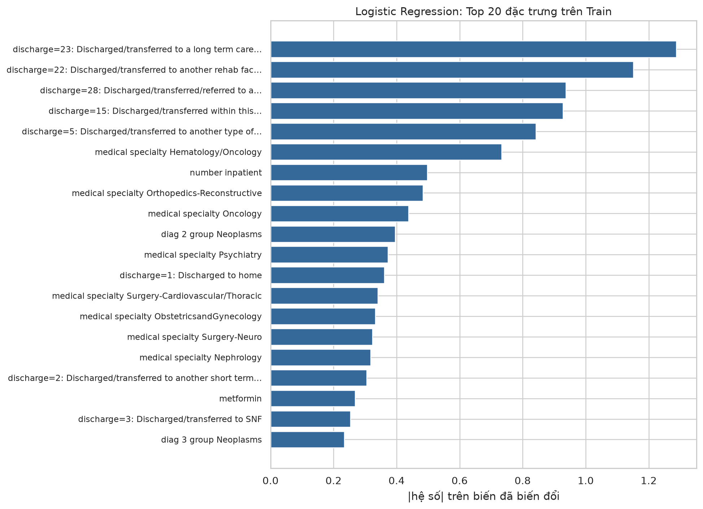

### feature_importance_random_forest

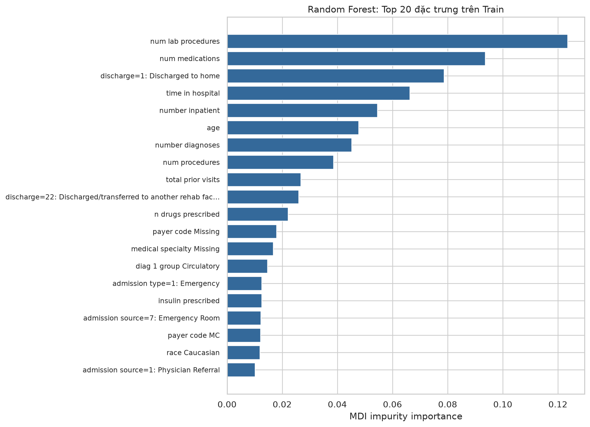

### feature_importance_lightgbm

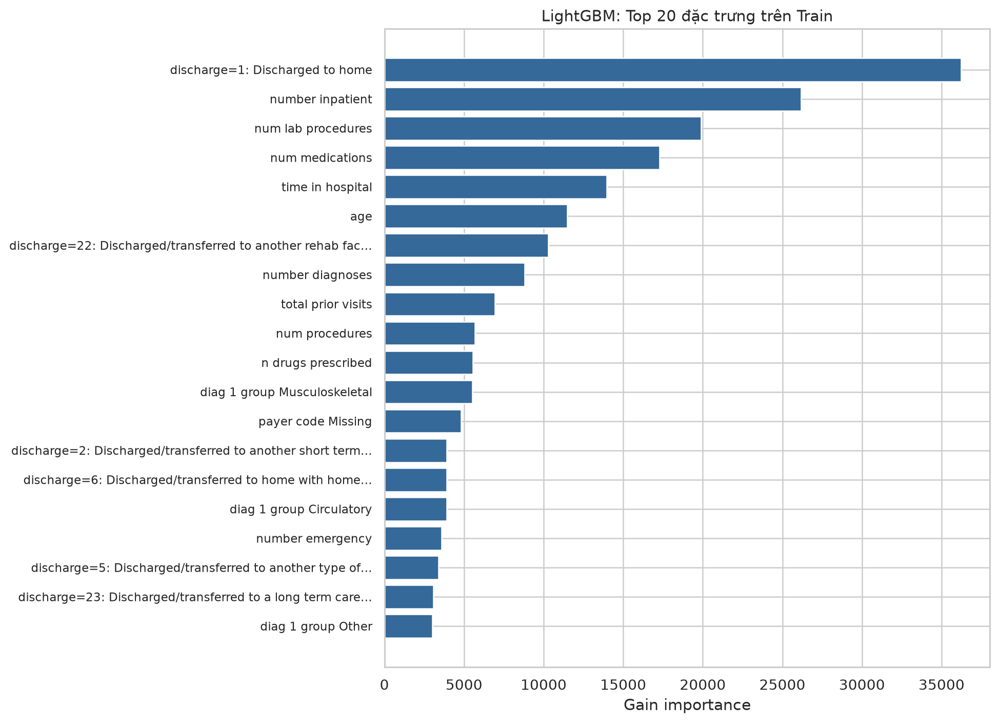

### shap_lightgbm_beeswarm

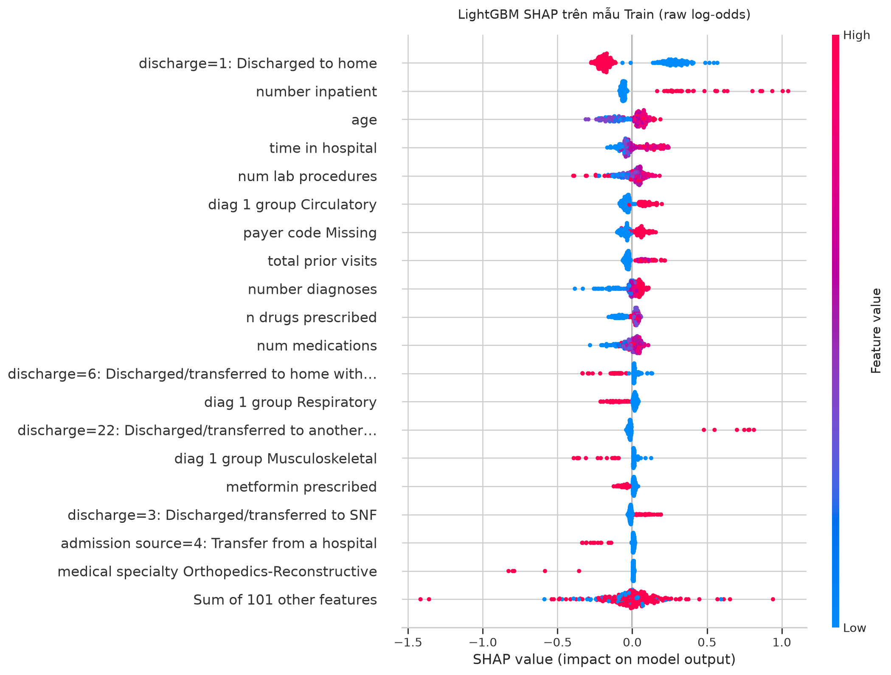

### shap_lightgbm_bar

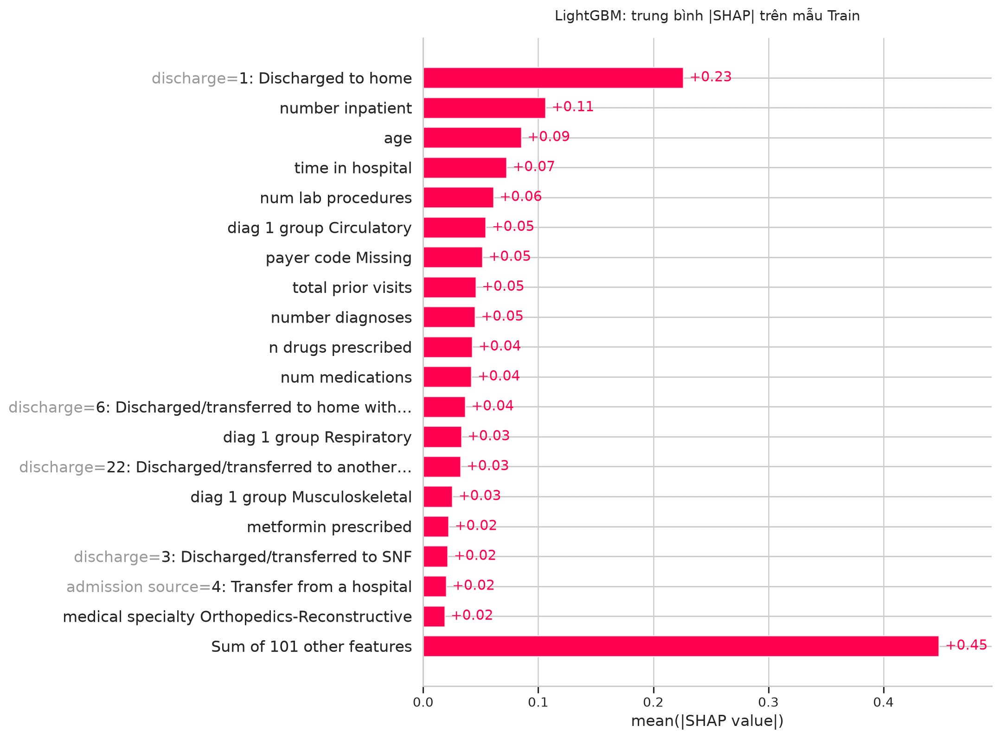
